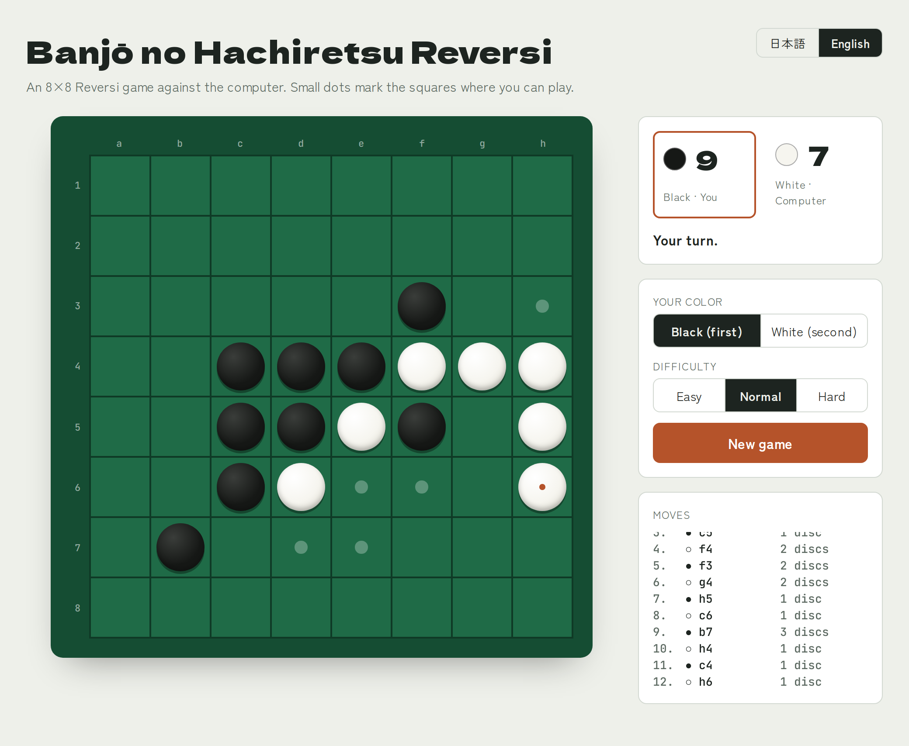

# Banjō no Hachiretsu Reversi

English | [日本語](README.ja-JP.md)

A single-file, browser-based Reversi (Othello-style) game where you play against the computer on an 8×8 board.
No build step, no dependencies — just open `othello.html` in a browser.



## Features

- Play as **Black (first)** or **White (second)**
- Three difficulty levels
  - **Easy** — mostly random moves, with a slight preference for flipping many discs
  - **Normal** — 2-ply search
  - **Hard** — 5-ply search, switching to an exact endgame solver when 10 or fewer squares remain
- Legal-move hints, last-move marker, and flip/place animations
- Live score display and move log (algebraic notation `a1`–`h8`, including passes)
- Automatic pass handling and game-over detection
- Responsive layout (side panel on wide screens, stacked on mobile)
- English / Japanese UI, switchable from the header (defaults to the browser language and remembers your choice)
- Light / dark theme following the OS setting
- Keyboard accessible, with screen-reader labels and `prefers-reduced-motion` support

## Getting Started

### Option 1: Open the file directly

Double-click `othello.html`, or drag and drop it into any modern browser (Chrome, Edge, Firefox, Safari).

### Option 2: Serve it locally

```bash
python3 -m http.server 8000
```

Then open <http://localhost:8000/othello.html>.

> Fonts are loaded from Google Fonts. The game works offline as well, falling back to system fonts.

## How to Play

1. Choose your color and difficulty in the side panel.
2. Click one of the squares marked with a small dot to place your disc.
3. All opponent discs sandwiched between your new disc and your existing discs are flipped.
4. If a player has no legal move, they pass. The game ends when neither player can move; the player with more discs wins.

Click **New game** to restart at any time. Changing your color also starts a new game; changing the difficulty takes effect from the next computer move.

## How the AI Works

- **Evaluation**: a positional weight table (corners +100, X-squares −50, etc.) plus a mobility term (difference in number of legal moves). Penalties on squares adjacent to a corner are cancelled once that corner is occupied.
- **Search**: negamax with alpha-beta pruning, with move ordering based on the weight table.
- **Endgame**: on Hard, when 10 or fewer empty squares remain, the search reads to the end and maximizes the final disc difference.

## Project Structure

```
.
├── othello.html       # The game (HTML + CSS + JavaScript in one file)
├── README.md          # This file (English)
├── README.ja-JP.md    # README (Japanese)
├── LICENSE.txt        # MIT License
└── images/            # Screenshots for the READMEs
```

## License

[MIT License](LICENSE.txt) © 2026 potofo
